<p align="center">
  
</p>

<h1 align="center">SparkMan</h1>

<p align="center">
  <strong>Fleet console for the DGX Spark / GB10 rack.</strong><br />
  One front door for AI coding agents, plus telemetry, logs, alerts, staged updates, benchmarks —<br />
  and Claude Code and Codex running on the host, in the browser.
</p>

<p align="center">
  
  
</p>

<p align="center">
  <picture>
    <source media="(prefers-color-scheme: dark)" srcset="docs/screenshots/overview-dark.png" />
    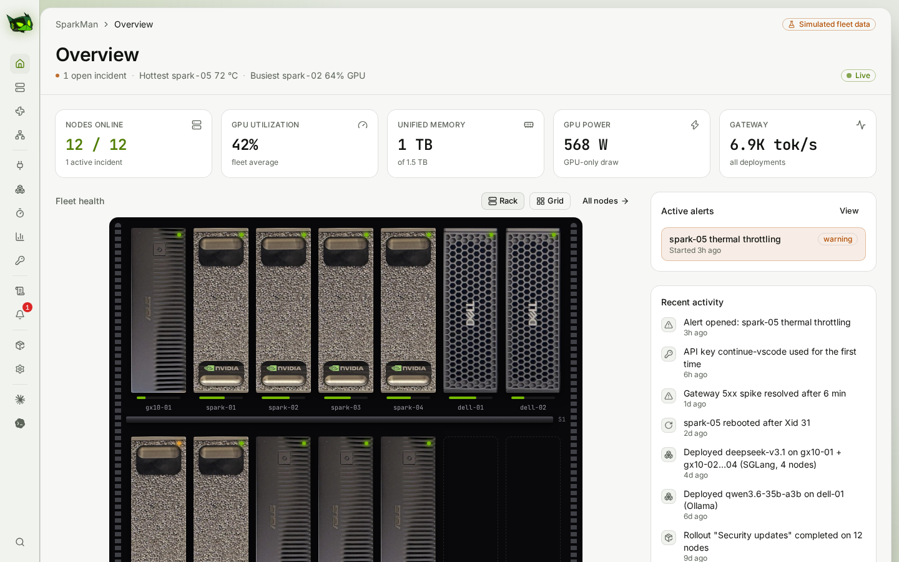
  </picture>
</p>

---

## What's in it

| | |
|---|---|
| **Overview** | The real rack, drawn from photos of the units, with status LEDs, GPU activity and hover stats; or a grid of cards. Live tiles, open alerts and recent activity. |
| **Nodes** | Per-node telemetry every 2 s (GB10 unified memory, GPU, power, thermals, ConnectX-7 traffic including RDMA), processes, inventory, health checks, reboot / drain / diagnostics. |
| **Cooling** | Three 140 mm fans in front of the top shelf on a Raspberry Pi Pico. SparkMan sets each fan from the hottest box in its zone (a drag-to-edit temperature curve plus a load floor that spins up before the heat shows), with manual override, live RPM, history, and a watchdog failsafe on the Pico. |
| **Network** | The fleet's switches, read-only: the 10G LAN switch over SNMPv3 and the QSFP fabric switch over RouterOS REST, each drawn from photos of its front panel with every port's live state, and its health, firmware and console cable. Hover a port for its peer, speed, MTU, traffic, errors, drops, pause frames, FEC and module; click it to open the node on the other end. Ports are matched to nodes by the switch's MAC table (LLDP as a fallback), and each node lists its own links and where they land. Alerts when a switch stops answering or a node's port runs below speed. |
| **AI Gateway** | One OpenAI- and Anthropic-compatible endpoint routed by model name, deployments (vLLM, Ollama, NIM, SGLang; single-node and ConnectX-7 groups), launchers that run your own start/stop scripts for any engine or multi-node ring, usage by model and key with the prompt-cache hit rate (prefill vs cached vs generated), API keys, and connect snippets for Claude Code, Codex and Kimi. |
| **Benchmarks** | Decode, prefill, quality (GSM8K, MMLU, …) and tool-calling benches after [sparkDash](https://github.com/MiaAI-Lab/sparkDash). Benches a node, a tensor-parallel group through its head, or every copy of a model through the gateway with a per-copy breakdown. Quality runs compare with a McNemar test. |
| **Observe** | Log explorer across journald, gateway, engines and kernel (NVRM Xid), with a histogram and incident bands; alert rules and incidents with timelines. |
| **Maintain** | DGX OS, apt and firmware updates rolled out ring by ring with approval; settings. |
| **Claude & Codex** | Claude Code (Agent SDK) and OpenAI Codex (`codex app-server`) running **on the SparkMan host**, with real permission modes and approvals, diffs, questions, plans, models, context and plan limits, MCP, skills, Codex plugins, rewind and fork. |

Every page's subtitle is a live status line — open incidents, the hottest node, errors in the last hour, nodes needing updates — instead of a description.

<table>
  <tr>
    <td width="50%">
      <picture>
        <source media="(prefers-color-scheme: dark)" srcset="docs/screenshots/claude-dark.png" />
        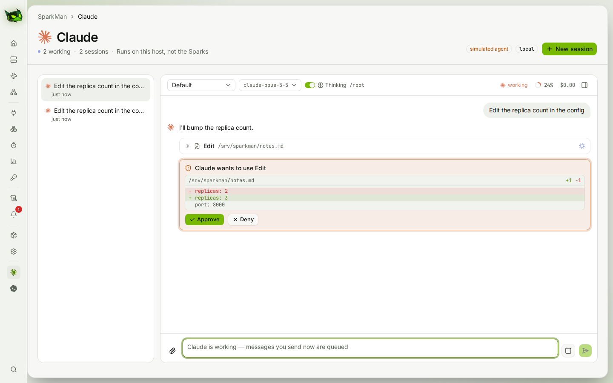
      </picture>
      <p align="center"><sub>Claude Code on the host — approve an edit from its diff</sub></p>
    </td>
    <td width="50%">
      <picture>
        <source media="(prefers-color-scheme: dark)" srcset="docs/screenshots/codex-dark.png" />
        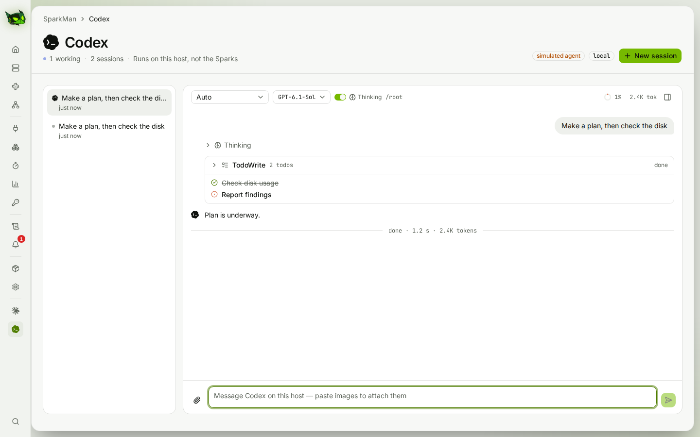
      </picture>
      <p align="center"><sub>Codex on the host — plans, reasoning, tokens</sub></p>
    </td>
  </tr>
  <tr>
    <td width="50%">
      <picture>
        <source media="(prefers-color-scheme: dark)" srcset="docs/screenshots/benchmarks-dark.png" />
        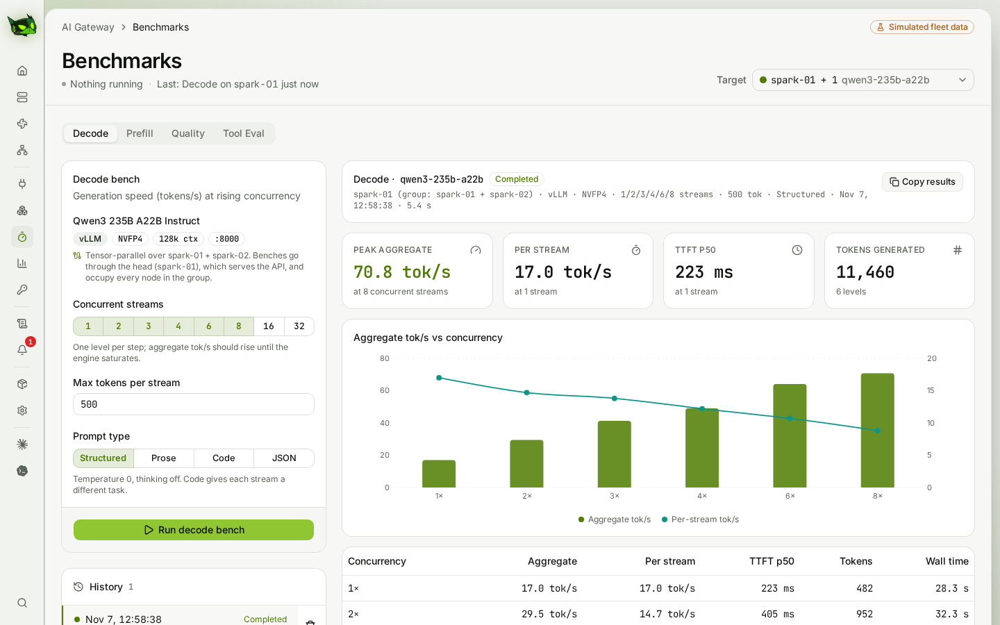
      </picture>
      <p align="center"><sub>Benchmarks — decode across concurrency on a TP group</sub></p>
    </td>
    <td width="50%">
      <picture>
        <source media="(prefers-color-scheme: dark)" srcset="docs/screenshots/node-detail-dark.png" />
        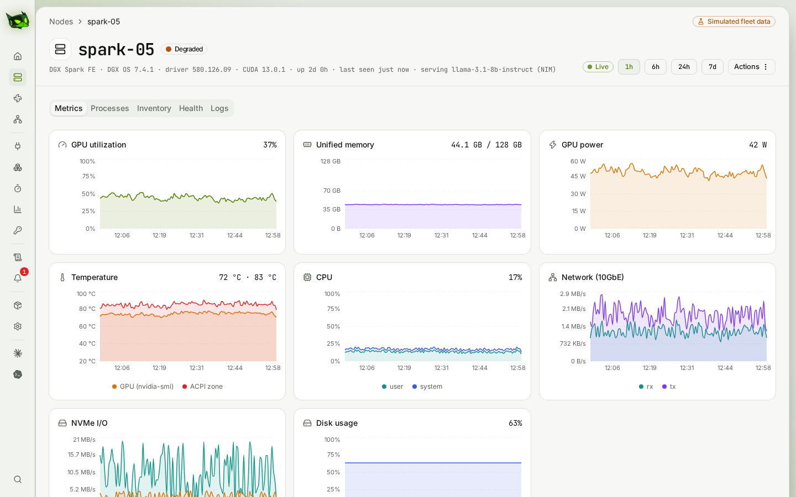
      </picture>
      <p align="center"><sub>Node detail — live GB10 telemetry</sub></p>
    </td>
  </tr>
  <tr>
    <td width="50%">
      <picture>
        <source media="(prefers-color-scheme: dark)" srcset="docs/screenshots/logs-dark.png" />
        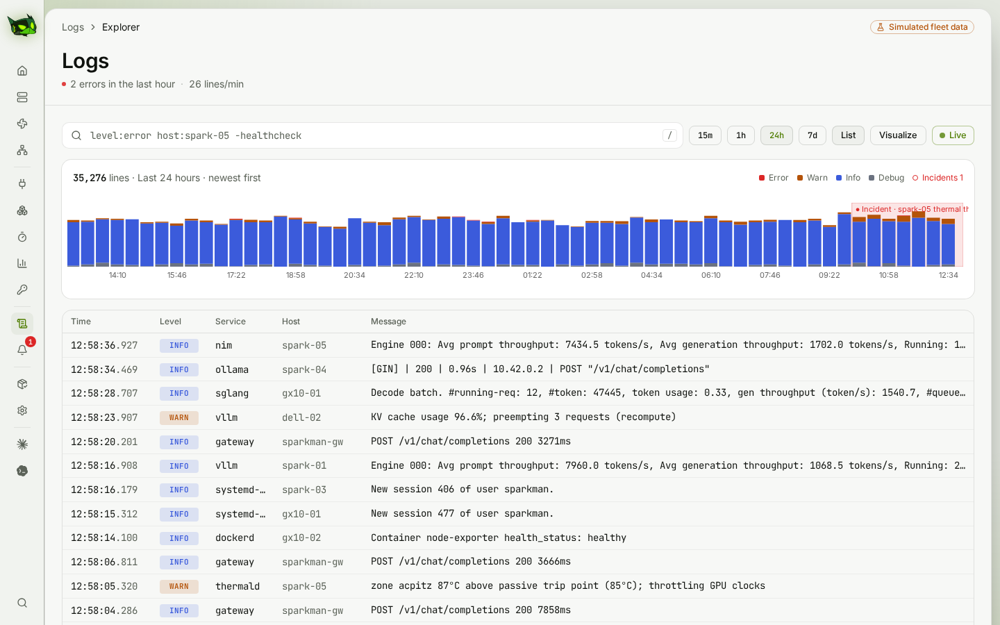
      </picture>
      <p align="center"><sub>Logs — every node, engine and the kernel in one place</sub></p>
    </td>
    <td width="50%">
      <picture>
        <source media="(prefers-color-scheme: dark)" srcset="docs/screenshots/deployments-dark.png" />
        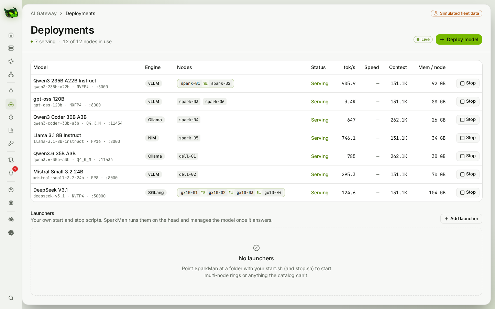
      </picture>
      <p align="center"><sub>Deployments — what each node serves</sub></p>
    </td>
  </tr>
  <tr>
    <td width="50%">
      <picture>
        <source media="(prefers-color-scheme: dark)" srcset="docs/screenshots/cooling-dark.png" />
        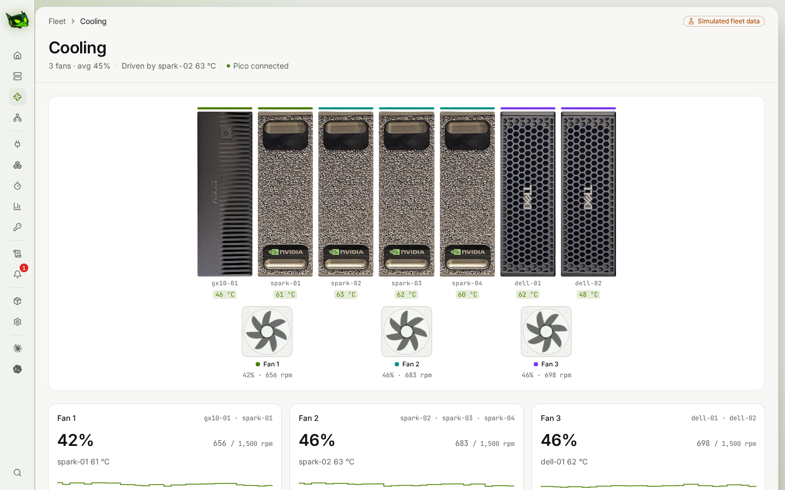
      </picture>
      <p align="center"><sub>Cooling — Pico-driven front fans, zoned by box</sub></p>
    </td>
    <td width="50%">
      <picture>
        <source media="(prefers-color-scheme: dark)" srcset="docs/screenshots/alerts-dark.png" />
        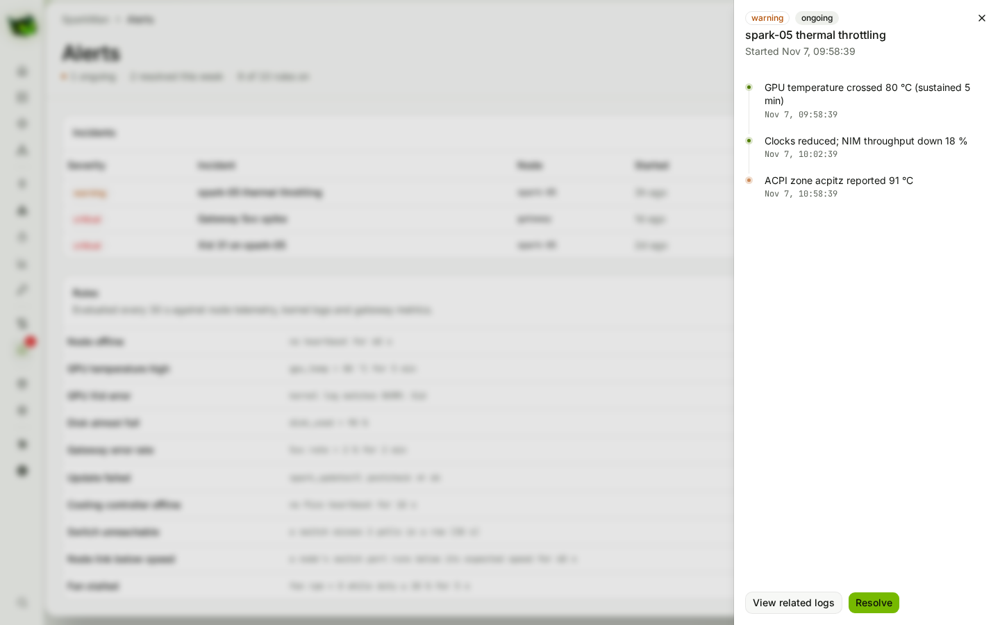
      </picture>
      <p align="center"><sub>Alerts — incidents with live timelines</sub></p>
    </td>
  </tr>
  <tr>
    <td width="50%">
      <picture>
        <source media="(prefers-color-scheme: dark)" srcset="docs/screenshots/network-dark.png" />
        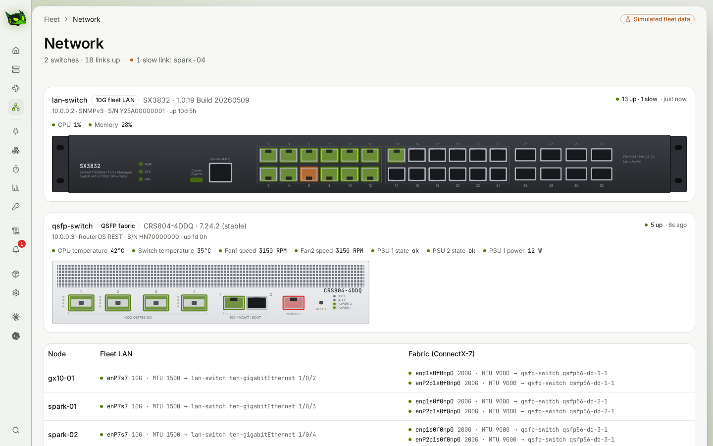
      </picture>
      <p align="center"><sub>Network — both switches, every port and what's on it</sub></p>
    </td>
    <td width="50%">
      <picture>
        <source media="(prefers-color-scheme: dark)" srcset="docs/screenshots/gateway-dark.png" />
        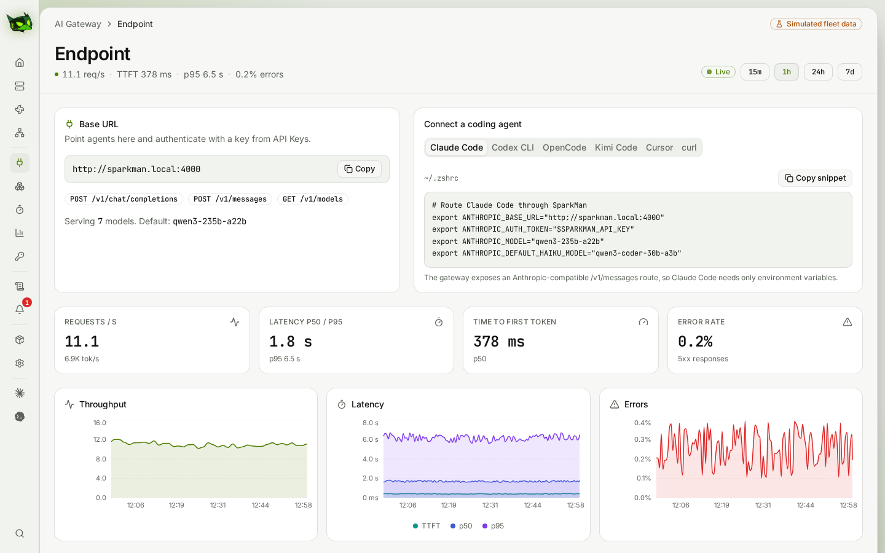
      </picture>
      <p align="center"><sub>AI Gateway — one endpoint, routed by model</sub></p>
    </td>
  </tr>
</table>

More in [`docs/screenshots`](docs/screenshots) (every page, light and dark).

## Live fleet or simulator

**Live.** On a host with a site config (`/etc/sparkman/fleet.json`), every page is real:

| Area | Where it comes from |
|---|---|
| Nodes, metrics | one SSH stream per box (`/proc`, `/sys`, `nvidia-smi` and the ConnectX-7 ports' RDMA counters every 2 s); history in SQLite (raw for a day, minute averages for 30 days) |
| Inventory, health, reboot, diagnostics | NVIDIA's DGX Spark lifecycle tools (`spark_updatectl`, `spark_diagctl`, `firmware_reporter`, …) over SSH |
| Logs | `journalctl -f -o json` from every box, a week hot, then gzip JSONL to an archive directory (e.g. an NFS mount) |
| Alerts | built-in rules over live telemetry and the kernel log (offline, GPU heat or throttling, Xid, ConnectX-7 link, disk, memory, NVMe), the fan controller (Pico offline, a fan stalled) and the switches (unreachable, a node's port below speed) |
| Updates | `spark_updatectl update check` + fwupd per node; ring-by-ring rollouts (dry run unless `SPARKMAN_ROLLOUT_APPLY=1`) |
| Deployments | discovered llama-swap / Ollama / vLLM / SGLang / TensorFold servers, plus single-node vLLM deployments SparkMan starts |
| Cooling | the Pico over USB serial (`firmware/pico-fan`): SparkMan sets each fan every second and reads its RPM back |
| Network | the switches listed in the site config, every 15 s: SNMPv3 (IF-MIB, BRIDGE-MIB, LLDP-MIB) or RouterOS REST, read-only accounts |
| AI Gateway, Usage, Keys | `sparkman-gateway`: one OpenAI- and Anthropic-compatible `/v1`, routed by model, with keys and per-request usage |
| Benchmarks | decode, prefill, quality ([sparkDash](https://github.com/MiaAI-Lab/sparkDash)'s suite, vendored) and tool-eval ([tool-eval-bench](https://github.com/SeraphimSerapis/tool-eval-bench)) |

**Simulator.** Without a site config (dev, e2e, the screenshots) the console runs on a deterministic in-browser
simulator.
Areas without a backend show **Not connected yet** rather than simulated data.

The **Claude** and **Codex** pages drive the agents installed on the SparkMan host.

## Run locally

Node 22+ and pnpm 10.

```bash
pnpm install
pnpm dev          # UI on http://localhost:5173
pnpm server       # host agents (Claude + Codex) on 127.0.0.1:4100 — Vite proxies /api/agent and /api/codex
pnpm server:fake  # scripted agents for UI work, no tokens spent
```

| Command | |
|---|---|
| `pnpm test` | unit tests (Vitest) |
| `pnpm e2e` | browser tests (Playwright; builds, then runs the server with fake agents on :5199) |
| `pnpm shots` | regenerate `docs/screenshots` |
| `pnpm build` · `pnpm typecheck` · `pnpm lint` | bundle · route generation + `tsc -b` · oxlint |
| `pnpm start` | production: build, then one process serving the UI and the agent API on :4100 |

## Deploy (Ubuntu)

As root (SparkMan's Claude and fleet SSH key are root's), the installer sets up two system services:
`sparkman` (UI, fleet backend, host agents) and `sparkman-gateway` (the model gateway, its own process so
restarting the console never cuts off a request).

```bash
git clone <repo-url> SparkMan && cd SparkMan
sudo ./deploy/install.sh                          # Node 22+, install, build, install + start both services
sudo cp deploy/fleet.example.json /etc/sparkman/fleet.json && sudo $EDITOR /etc/sparkman/fleet.json
sudo pnpm user:set <name>                         # console account (sign-in turns on once one exists)
sudo systemctl restart sparkman
sudo tailscale serve --bg 4100                                        # https://<host>.<tailnet>.ts.net
sudo tailscale serve --bg --set-path /v1 http://127.0.0.1:4200/v1     # the gateway at …/v1
```

- **Site config** (`/etc/sparkman/fleet.json`, never in git): SSH user and key, the boxes with their rack
  slot and update ring, ConnectX-7 groups (head first), and optionally a dnsmasq leases file and enrollment
  snapshots to fill in addresses, serials and BIOS versions, and the switches for the Network page (address,
  read-only credentials file, the speed a node's port should run at, and optionally the console cable's serial
  device). See `deploy/fleet.example.json`.
- **Each box** needs the SSH key with passwordless sudo, NVIDIA's lifecycle tools in `/opt/dgx_spark_management`,
  Docker with the NVIDIA runtime (for deployments) and a firewall that lets the SparkMan host in.
- **Accounts:** `pnpm user:set|remove|list` (scrypt hashes in `/etc/sparkman/users.json`). Sessions are 30-day
  HttpOnly cookies; five failed sign-ins a minute are throttled.
- **Gateway keys** are created on the Keys page; clients use `https://<host>.<tailnet>.ts.net/v1` with the key as
  a bearer token (or `x-api-key`).
- **Update:** `./deploy/update.sh`. **Logs:** `journalctl -u sparkman -u sparkman-gateway -f`.
- As a normal user, `./deploy/install.sh` installs one systemd *user* service instead (the console and host
  agents, without the separate gateway service; settings in `~/.config/sparkman`).
- **Fans:** wiring, the serial protocol and the bridge are in [the cooling spec](docs/superpowers/specs/2026-10-09-sparkman-cooling-design.md#6-phase-2-the-sparkman-host--built-2026-11-03).

### Installing models

`docs/playbooks/model-install.md` is the step-by-step for putting a model on the fleet (library download, copy,
multi-node prerequisites, first start, SparkMan launcher), written so an AI agent can follow it. Site specifics go
in `/etc/sparkman/site-notes.md` next to the site config, not in the repo.

## The simulator

- 12 nodes, seeded and ticking every 2 s. The top shelf mirrors a real rack, left to right: an ASUS Ascent GX10, four DGX Sparks and two Dell Pro Max GB10s; shelf 2 is placeholder.
- `spark-05` runs hot (an ongoing thermal incident) and one of the Dells has a pending reboot.
- **Settings → Simulator** takes a node offline, disconnects the Pico or stalls a fan, or injects gateway 5xx errors, an Xid storm or failing API requests. State is in memory and resets on reload.

## Claude and Codex on the host

- **Claude** uses the Claude Agent SDK with the host's Claude Code login, settings and `CLAUDE.md` files. Permission modes as in the CLI (Default, Accept edits, Plan, Auto, Don't ask, Bypass); `/` commands and skills; model, thinking and context controls; MCP, subagents, background tasks; question and plan-approval cards; image attachments; rewind files and fork sessions.
- **Codex** drives `codex app-server` (the protocol the IDE extensions use): live approvals for commands and patches ("always allow this session" too), questions, plans, reasoning summaries, models, MCP status, skills, plan limits and Codex **plugins** (browse, install, remove). Modes: Read only, Auto (default), Ask every time, Full access. On a ChatGPT plan Codex reports tokens, not dollars.

### Security model

- The server binds to loopback only (it refuses other `SPARKMAN_HOST` values); publish it with `tailscale serve`.
- Every request must come from a loopback socket with a `Host`/`Origin` of `localhost`, `127.0.0.1`, `[::1]`, a `*.ts.net` name or one of `SPARKMAN_ALLOWED_HOSTS` — this blocks DNS-rebinding pages.
- State-changing requests must be JSON, so there are no cross-site form posts.
- Tailscale Serve requests must carry an allowed `Tailscale-User-Login`; requests without one are accepted only directly from the host.
- **Bypass (Claude) and Full access (Codex) are off** unless `SPARKMAN_ALLOW_BYPASS=1`, and sessions saved in those modes fall back when the host doesn't allow them.
- Use plain `tailscale serve <port>` (HTTP proxy). The `--tcp` / `--tls-terminated-tcp` modes add no identity headers and must not be used.
- Sessions skip Claude Code's folder-trust prompt: a repo's project settings and hooks apply as soon as you open a session in it.

### Environment

| Variable | Default | Meaning |
|---|---|---|
| `SPARKMAN_ALLOWED_USERS` | (empty) | Comma-separated Tailscale logins allowed in |
| `SPARKMAN_ALLOWED_HOSTS` | (empty) | Extra Host names to accept (loopback names and `*.ts.net` always are) |
| `SPARKMAN_ALLOW_BYPASS` | (off) | `1` offers Claude's Bypass and Codex's Full access |
| `SPARKMAN_PORT` / `SPARKMAN_HOST` | `4100` / `127.0.0.1` | Listen address (loopback only) |
| `SPARKMAN_AGENT_CWD` | home dir | Default working directory for new sessions |
| `SPARKMAN_AGENT_MODE` | `default` | Default Claude permission mode |
| `SPARKMAN_AGENT_MODEL` | Claude Code's default | Claude model override |
| `SPARKMAN_DATA_DIR` | `~/.sparkman/agent` | Session index and event logs (Codex sessions in `codex/` inside it) |
| `SPARKMAN_CODEX_BIN` | `codex` on PATH | Codex CLI to run as `codex app-server` |
| `SPARKMAN_CODEX_MODEL` | Codex's default | Model for new Codex threads |
| `SPARKMAN_CODEX` | (on) | `0` hides the Codex page |
| `SPARKMAN_FLEET_CONFIG` | `/etc/sparkman/fleet.json` | Site config; without it the console uses the simulator |
| `SPARKMAN_FLEET` | (on) | `0` ignores the site config |
| `SPARKMAN_FLEET_DB_DIR` | `~/.sparkman` | Fleet, logs and gateway SQLite files |
| `SPARKMAN_USERS_FILE` | `/etc/sparkman/users.json` | Console accounts; sign-in is on when it exists |
| `SPARKMAN_AUTH` | (on) | `0` turns sign-in off |
| `SPARKMAN_LOGS` | (on) | `0` turns log collection off |
| `SPARKMAN_LOG_ARCHIVE` | (none) | Existing directory for logs older than a week (gzip JSONL per host and day) |
| `SPARKMAN_ROLLOUT_APPLY` | (off) | `1` lets rollouts really install updates and reboot; otherwise every rollout is a dry run |
| `SPARKMAN_GATEWAY` | (on) | `0` turns off the gateway, deployments, usage, keys and benchmarks |
| `SPARKMAN_GATEWAY_PORT` | `4200` | Gateway listen port (loopback only) |
| `SPARKMAN_TOOL_EVAL_BIN` | (none) | `tool-eval-bench` executable; the Tool Eval bench is off without it |
| `SPARKMAN_TOOL_EVAL_USER` | (none) | Unprivileged account to run tool-eval-bench as |

## Stack

Vite · React 19 · TypeScript · Tailwind 4 · shadcn/ui · TanStack Router & Query · Recharts · Motion · Hono (host server) · Claude Agent SDK · Codex app-server · Vitest · Playwright.

## Credits

Benchmark methodology after [sparkDash](https://github.com/MiaAI-Lab/sparkDash) (Apache-2.0), whose quality suite is vendored in `server/bench/vendor/sparkdash`; quality items sample GSM8K and MMLU (MIT); tool eval after [tool-eval-bench](https://github.com/SeraphimSerapis/tool-eval-bench) (MIT). Brand icons from [simple-icons](https://simpleicons.org) and [LobeHub Icons](https://github.com/lobehub/lobe-icons) (MIT). The SparkMan character was conceived in Midjourney and vectorized in Illustrator with Codex.

Design notes: [`docs/superpowers/specs`](docs/superpowers/specs).

## License

[Apache License 2.0](LICENSE). The vendored sparkDash suite in `server/bench/vendor/sparkdash` keeps its own Apache-2.0 license.
